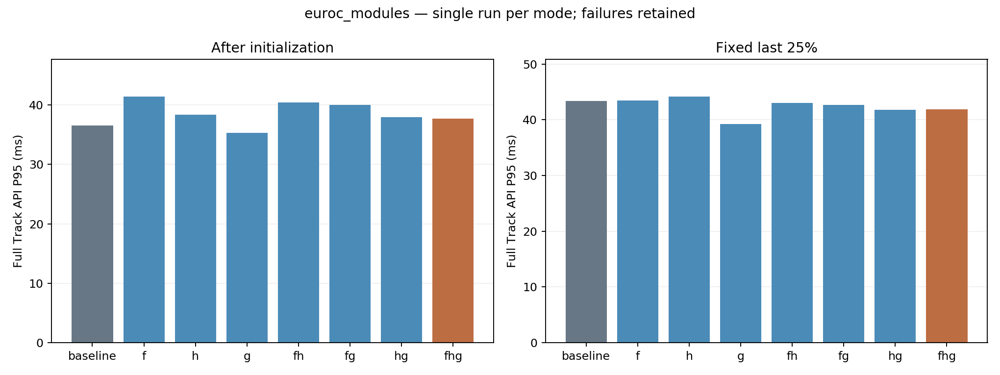
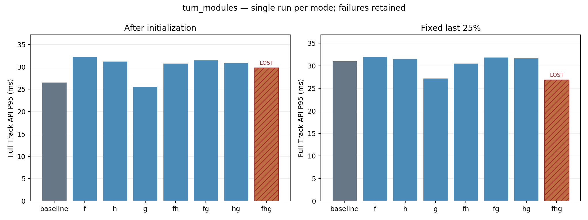

# GF03：三个模块逐项核对与组合实测

更新：新的主 baseline 为官方 ORB-SLAM3，同时已实测交付加速版。
结果见 [GF04 版本对照](../orb_slam3_controls_20260928/REPORT.md)。以下保留本轮GF内部消融历史数据。

已完成三个模块的源码逐项对照、八种配置在两套数据上的单轮测试，共 16 轮、63,752 帧。15 轮初始化后持续正常；TUM 全开 FHG 在第 4126 帧失跟，后续 931 帧 non-OK。**本轮没有配置同时通过所定延时与质量筛选，不建议直接全开移植。** 这是一轮筛选结果，不是失败概率或稳定收益的估计。

## 版本、范围与参数

本轮验证三个已有模块：F=Good Feature Matching，H=局部地图 MIH+OTS，G=固定规模 Good Graph。模式是 baseline、F、H、G、FH、FG、HG、FHG。详细逐项实现位置及未启用分支见 [CODE_AUDIT.md](CODE_AUDIT.md)。

官方基点 `2a60498cb889965bd5b4ab05c918ab28b433e882`；GF02 父提交 `33e506481bf4daf8bf37b1f4377950c28a8c54a7`；本轮源码 `1ad2246b2aac4357a2990c80ced84a41ef6d0d64`。实验根目录为 `/home/ywl/Project/RDK_X5_orb_slam/gf_orb_slam2_modules_20260928`。IDE 仓库检查点为 `39e5ebaf`、`29c41fa3`；最终证据提交可从本报告的 Git 历史定位。

本轮仅新增 SLAM++ 依赖发现适配及 F 的实际分支计数。G 使用原有 SLAM++ Schur/随机贪心选图代码，最终仍用 g2o 做 BA；编译失败的旧 Eigen BLAS/LAPACK 包装器改由系统 BLAS/LAPACK 链接替代，失败日志保留。三个算法没有在矩阵进行中修改。

这里的 baseline 是同一 GF-ORB-SLAM2 分支关闭 F/H/G，不是另外编译的原版 ORB-SLAM2，也不是板端 ORB-SLAM3。比较中底层版本一致，因此不能把此处的差异归因于 ORB2/ORB3 代际；本实验本身也不能量化两代系统之间的性能差异。

| 项目 | 固定设置 |
|---|---|
| 主机 | Ryzen 7 4800H，8 核 16 线程，约 22.8 GiB RAM；Ubuntu 20.04 / GCC 9.4 / OpenCV 4.2 |
| 输入 | EuRoC V1_01_easy 单目 2912 帧；TUM fr2_large_with_loop RGB-D 5057 对 |
| 测试轮数 | 用户要求每组单轮：8×2=16 个正式运行；不是每组 3 次 |
| 回放 | 1× 时间戳顺序，不主动跳帧；过载时积压并继续处理全部输入 |
| 特征 | 每图配置 800 个 ORB、8 层；标定、词典及匹配阈值统一 |
| F | 400 标量约束目标、原有 15 ms 局部匹配预算；已有匹配先验及跨帧预计算关闭，原矩阵多线程保留 |
| H | legacy 桶策略加继承的公共同步修复；32 表，初始/最多 8 个活动表；2000 点触发、信息阈值 80 |
| G | 固定目标 30 个自由 KF，候选上限 60；动态预算和虚拟帧预测未启用；选图二维信息，最终 RGB-D BA 保留深度 |
| 其他 | GPU、viewer、外部真值先验、回环及地图保存均关闭；BLAS/OpenMP/MKL 限 1 线程 |

800 是配置目标，逐帧实际检测数量见原始 CSV，并非每帧严格等于 800。各数据内运行顺序均为上表八个模式顺序。单轮没有平衡时间漂移，也没有估计跨轮方差。主机沿用 `ondemand` 调频；未锁频、未关闭用户桌面服务。不能把微小差异解释为已证实的普遍提升。主机环境快照见 `logs/host_environment.json`。

## 计量与质量门槛

主指标为整个 `TrackMonocular/TrackRGBD` 返回耗时：包括可选后处理，不包括 PNG 解码。内部 pose-ready 表示后处理之前的位姿就绪时刻，不能替代整个 API，也不等于板端 ROS 回调/发布延时。记录全段、初始化后、固定输入最后 25%，包含初始化后全部慢帧；没有删除异常耗时来改善统计。

输入滞后另计，包含读图和积压；“帧数完整”不表示每帧都赶上标称周期。所有模式的 CPU、RSS 和进程 Swap 每 2 秒采样。局部地图计数按全部帧平均时包含 F 跳过局部跟踪的帧，条件化统计另见 `analysis.json`。

单轮筛选门为：输入完整且初始化后不丢跟踪；相对本数据 baseline，初始化后 API P95 至少降低 5%，P99 不恶化超过 5%；ATE、1 秒平移/旋转 RPE 不恶化超过 5%，近零基线采用 5 mm / 0.1° 绝对容差；已启用模块必须实际进入。该门槛用于筛选，单轮通过也不能代替重复稳定性验收。

EuRoC 使用一个全局 Sim(3) 对齐，RGB-D 使用 SE(3)、不拟合尺度。TUM 真值仅覆盖约 24.3% 的输出，最大真值间隙 129.865 s；因此 TUM 相对精度筛选不等于全轨迹精度通过。逐轮数值和机器结果以 [DETAILS.md](DETAILS.md)、`run_details.csv`、各矩阵 `analysis.json` 为准。

## 实测结果

### EuRoC V1_01_easy，单目

下表 API 统计为初始化后全部输入帧；尾段为固定输入最后 25%，单位 ms。

| 模式 | API mean | API P95 | API P99 | 尾段 P95 | ATE m | non-OK |
|---|---:|---:|---:|---:|---:|---:|
| baseline | 26.16 | 36.57 | 57.31 | 43.41 | 0.0336 | 0 |
| F | 31.47 | 41.43 | 63.88 | 43.43 | 0.0326 | 0 |
| H | 24.93 | 38.37 | 54.69 | 44.19 | 0.0345 | 0 |
| G | 26.02 | 35.32 | 50.32 | 39.22 | 0.0338 | 0 |
| FH | 26.14 | 40.44 | 55.32 | 43.05 | 0.0335 | 0 |
| FG | 29.98 | 39.96 | 50.79 | 42.67 | 0.0394 | 0 |
| HG | 24.94 | 37.95 | 50.89 | 41.74 | 0.0325 | 0 |
| FHG | 25.29 | 37.70 | 46.37 | 41.86 | 0.2913 | 0 |

### TUM fr2_large_with_loop，RGB-D

下表 API 统计为初始化后全部输入帧；尾段为固定输入最后 25%，单位 ms。

| 模式 | API mean | API P95 | API P99 | 尾段 P95 | ATE m | non-OK |
|---|---:|---:|---:|---:|---:|---:|
| baseline | 19.28 | 26.53 | 38.90 | 30.98 | 0.7464 | 0 |
| F | 22.93 | 32.32 | 41.06 | 32.05 | 0.9380 | 0 |
| H | 19.63 | 31.22 | 37.74 | 31.51 | 1.3497 | 0 |
| G | 18.87 | 25.54 | 34.03 | 27.18 | 0.9454 | 0 |
| FH | 20.24 | 30.79 | 38.12 | 30.50 | 0.6201 | 0 |
| FG | 22.27 | 31.46 | 36.73 | 31.86 | 1.1041 | 0 |
| HG | 19.34 | 30.90 | 35.93 | 31.67 | 1.1237 | 0 |
| FHG | 18.47 | 29.77 | 36.57 | 26.84 | 不纳入（失跟） | 931 |

TUM FHG 的延时保留了 931 帧失跟处理，不可作为加速收益；其固定后 25% 中有 73.7% 输入处于 LOST。局部轨迹可算出 0.2846 m ATE，但仅匹配到 590 个真值位姿，其他成功组为 1227；这个更小的数字不能解释为精度更好。

### 各模块和组合的结论

1. **F 有实际运行，但本配置下增加了局部阶段成本。** EuRoC 主动分支进入 2396 帧，局部阶段均值 8.90→13.66 ms；RGB-D 主动分支 3351 帧，6.78→10.14 ms。原有 400 约束目标、矩阵计算和主动搜索在这两组输入上没有换来整体加速。不能外推为其他预算或论文配置必然无效。
2. **H 的候选压缩有效，完整调用的长尾收益未成立。** EuRoC 局部点均值 3818→650，RGB-D 2330→809；但补充匹配、信息构造及选表等后处理增加。RGB-D pose-ready 均值 18.79→17.22 ms，post 均值 0.39→2.31 ms，完整 API 均值 19.28→19.63 ms，P95 26.53→31.22 ms。源码 Combined 分支仍先扫描共视点槽，且当前桶策略和查询输入不等于论文全部语义。
3. **G 的规模控制生效，收益取决于序列。** 所有 G 组的 BA 自由 KF 上限均为 30。单独 G 的 API P95 在 EuRoC 下降 3.42%，RGB-D 下降 3.75%；尾段 P95 分别下降 9.64%、12.29%。但 RGB-D ATE 从 0.7464→0.9454 m，平移 RPE 从 0.0970→0.1165 m，未通过质量门。
4. **G 并非在所有后台指标上变快。** EuRoC BA 调用 P95 为 542.42→429.75 ms，均值为 205.20→234.96 ms；RGB-D BA P95 反而为 224.57→284.88 ms。当前实现先构建选图问题，再判断是否需要缩图，小图调用也可能承担构建开销；G 组的图本身也随跟踪变化，不能把全部差值归因于一个算子。未埋点 BA 完成/中断结果，因此不能声称完成率改善。
5. **组合不产生简单叠加收益。** FH 在 EuRoC 将 F 主动分支从 2396 降至 218 帧，符合 H 缩小可见候选后更多走普通匹配分支的实现；TUM FH 的相对误差有所改善，但 API P95 增至 30.79 ms。FG 在 EuRoC 精度退化。FHG 在 EuRoC ATE 增至 0.2913 m，约为基线的 8.7 倍，在 TUM 又发生失跟。三者同时打开不能作为当前推荐配置。

上述结论是同一 ORB2 派生代码上的测量，并不支持“只因为生产工程基于 ORB3 才不能复现”。差异还包括启用变体、预算、传感器、数据规模、硬件，以及计时是否包含后处理。本轮既不是论文完整动态 Good Graph，也不是所有序列/参数/历史论文版本的复刻。

### FHG 失跟与恢复边界

TUM FHG 首次 LOST 为输入 index=4126，timestamp=1311875713.0555251。此前四帧局部内点为 41、38、30、25；首次失跟帧运动模型和参考关键帧跟踪都报告失败，局部地图匹配未实际执行，最终有效关联仅 9 个。更早的地图/选择历史可能有关，但这些日志不足以确定首次失败根因，未以一次失败估计复现概率。详见 `failure_diagnostic.json`。

恢复还有一个共同测试边界：本轮 `DISABLE_LOOP_CLOSURE` 使 `LoopClosing::Run()` 跳过正常处理，同时不再执行 `DetectLoop()` 内的 `KeyFrameDatabase::add()`；没有加载现成地图。后续重定位日志持续报告共享词关键帧列表为空。因此初次失跟仍是本轮 FHG 的明确失败，但持续未恢复还受到共同关闭回环方式的影响，不能声称完整重定位能力已经验证。原始运行保持不变，未为改善结果中途补填数据库。

### 资源、输入积压与诊断缺口

16 轮都处理了完整输入，索引连续、时间戳递增、CSV 数值有限、pose-ready 不超过完整 API；全部正常退出。峰值 RSS 约 763–1405 MiB，进程 Swap 峰值均为 0。TUM F 的输入滞后 P95 达 507.47 ms，说明完整处理输入与严格跟上回放节奏是不同指标。更多 CPU、BA、地图规模及帧周期超时数据见 [DETAILS.md](DETAILS.md)。

**诊断缺口：FG/HG/FHG 两套数据均没有 `input_lateness_ms` 列。** 最终增量构建保留了这三个旧版 driver；最后一次构建日志没有为它们重编译 replay.cc。历史 driver SHA 为 `d85f25dc…`，新增滞后列版本为 `2a5138f5…`，两个完整源码快照均保留。二者文本差异是调用前计算滞后和多写一列，Track 调用、已有耗时端点、状态和轨迹输出一致；新增诊断的微小开销没有单独标定，因此不声称八组 driver 字节级一致。

此前“全部 driver 已重建、都有积压列”的进度判断不准确，此处予以更正。冻结审计证明测量期间文件和二进制未变，不能代替编译来源一致性证明。缺失字段保留为未测，不补造、不修改原始 run.json 或冻结二进制；来源说明及差异见 `diagnostic_gaps.json`、`driver_diagnostic_delta.patch`。按节省测试时间的要求，不仅为这一附加字段重跑六个完整序列。

正式单轮筛选结果见 `comparison_summary.json`：两套数据各七个增强候选均未通过全部门槛。保留“模块组合能够构建和执行”的正面证据，同时保留质量失败和诊断缺口；没有生产准入。

## 验证、证据与回退

- 八个 CPU 目标完成构建；最终增量构建中五个 driver 重编译，三个沿用旧诊断版本，见上文缺口。构建日志及依赖清单保留。
- 16 次短功能运行合计 7600 帧，全部完整且初始化后 non-OK=0。它们与构建曾有重叠，只用作功能证据，不计入正式性能比较。
- 轨迹分析工具 3 项测试通过；输入列表与原始索引一致，数量、时间顺序、RGB-D 时间差和本地文件存在性已检查。
- 正式测量前冻结源码、二进制、配置、词典及输入列表；原 GF01/GF02 的 16 个二进制哈希保留。结束审计通过：16 个正式运行、63,752 帧，15 轮无初始化后丢跟踪；24 个本轮二进制/依赖、16 个前序二进制及冻结文件均未变。额外诊断列并非全部可用，已单独标明。
- 用户缩减轮数时，保留已完成的 EuRoC baseline；中断的首个 F 部分运行移至 `runs/cancelled_on_user_repeat_reduction`，从正式矩阵排除，未删除原始记录。后续用独立 `run_matrix_once.py` 续跑，原冻结 driver 保持不变。
- 功能预检期间的一次源文件冻结检查中断已记入 `logs/functional_freeze_note.txt`；恢复后完成剩余预检，正式测试前构建命令覆盖全部八组，但末三组 driver 增量复用问题直到最终 CSV 审计才发现。运行期间的冻结检查未失败；这不消除上文诊断来源缺口。

复现命令见 [README.md](README.md)。完整原始 CSV、轨迹、console、资源样本留在独立实验根目录；IDE 证据目录保存紧凑结果、图表、patch、manifest 和原始文件 SHA256 索引。所有时间、完整性及精度失败均须保留。

本轮没有修改或部署生产 ORB-SLAM3/MEM18/perf20，没有访问板卡或生成地图文件。回退即继续使用原生产版本；独立实验不改变其默认开关。未运行 GF03 全系统 ASan/TSan、板端 ROS、回环、保存重载、完整 EuRoC 集合或 NewCollege 长序列，不把此次运行正常解释为这些场景已获验证。
