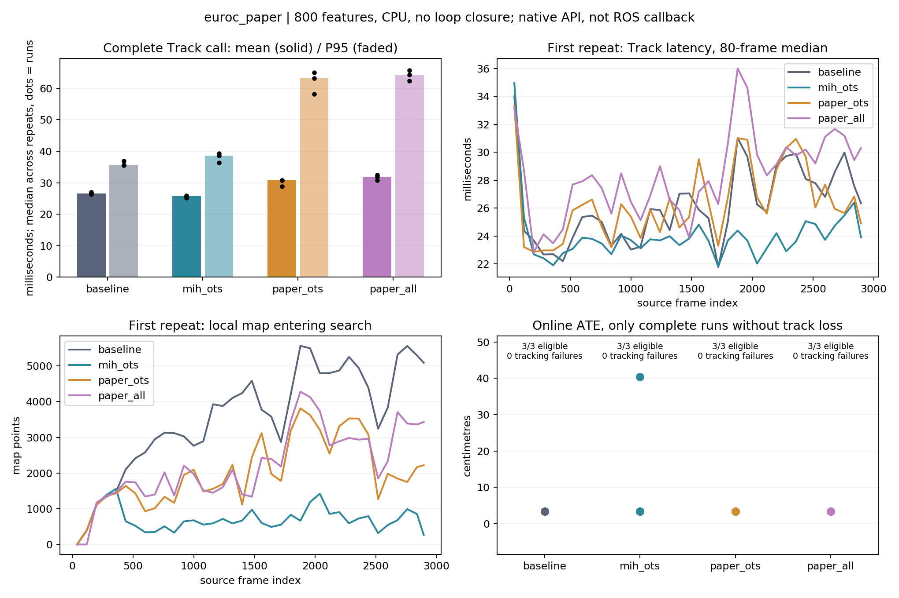
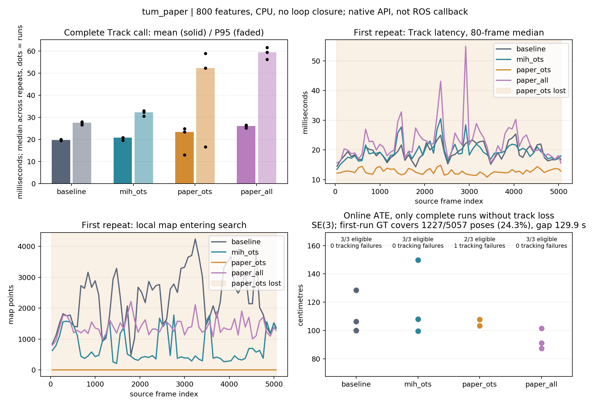
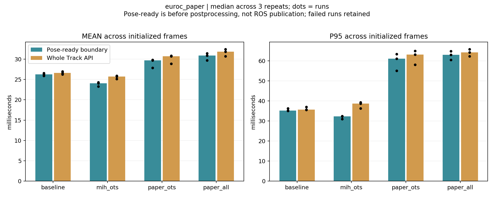

# GF02：依据论文修正 MIH 后的实际测试

**已修改并完成 24 轮正式回放、95,628 帧。桶容量与重访语义得到修正，但这份实现在本机两个序列上没有获得稳定的整体延时收益；修正组反而更慢，其中一组有一次启动期丢跟踪。**

这是独立 GF/ORB2 实验，生产 ORB-SLAM3 和 RDK-X5 没有部署改动。本轮复现交付完成，不代表优化候选通过实时性或质量准入，也不构成对论文全部实验的否定。

关于 ORB-SLAM2：它影响移植接口、生命周期和比较条件，但**不能解释本次同一 GF/ORB2 分支内部的性能退化**。详细源码对照见 [ORB2 与 ORB3 的关系](ORB2_VS_ORB3.md)。

## 实际修改及来源

工作目录：`/home/ywl/Project/RDK_X5_orb_slam/gf_orb_slam2_paper_20260928`，源码在 `upstream/`，分支 `repro/paper-buckets-20260928`。这是独立 worktree，共用 GF01 的 Git 对象库；GF01 文件和构建产物的 SHA256 核验均未改变。

- 官方 catkin 来源：`2a60498cb889965bd5b4ab05c918ab28b433e882`，父级本地兼容版本 GF01：`39e794af2ec4ba8c8fd2665a748de5551e35b161`。
- 本轮源码提交：`33e506481bf4daf8bf37b1f4377950c28a8c54a7`。
- 实现、设计及短测证据提交：`ee1c6bec`；本报告所在提交为完整矩阵的最终证据提交。
- 开始时 IDE 仓库 `4a99b5e7` 及 GF01 源码均干净，没有未保存用户修改。

根据[论文 III/IV](https://arxiv.org/html/1905.07797)与[公开源码](https://github.com/ivalab/gf_orb_slam2/tree/2a60498cb889965bd5b4ab05c918ab28b433e882)的差异，实现了真实容量 10、重访移至队首、去重/淘汰/重插入、描述子变化时清理旧键，以及独立的全部描述子查询开关。采用有界 deque 实现最近访问语义，不声称容器布局与作者 ring buffer 相同。反向成员表只保留仍驻留于至少一个桶的点，避免它随全部历史点无限增长。

三个哈希构建共用同步修复：索引操作与重置同步、桶读写同步、Tracking/Mapping 共视列表交换加锁，Reset 等后端确认后先清索引再清地图；取消 Mapping 无同步写入 Tracking 每帧计时字段。修正策略之外的这些变化也进入旧策略控制组，因此不是拿有竞争的旧桶读写与同步后的候选比较。它们与 GF01 历史轮次存在差别，不能直接跨批次作因果比较。

| 模式 | 桶行为 | 查询描述子 |
|---|---|---|
| baseline | 同一 GF 分支关闭哈希，原共视路径 | 无 |
| mih_ots | 无硬容量，已插入点不刷新 | 公开实现的未匹配特征 |
| paper_ots | 容量 10、重访刷新、淘汰与描述子迁移 | 同上 |
| paper_all | 同 paper_ots | 全部当前帧描述子 |

这些名称表示消融配置，**paper_ots/paper_all 不表示完整论文复刻**。OTS 信息矩阵、正则化、时间预算和额外匹配仍沿用当前公开版本；Mapping 仍使用最新 Tracking 共视列表，并保留创建/替换点时的既有插入点。预先确定的边界见 [DESIGN](DESIGN.md)。

## 固定条件与测量

AMD Ryzen 7 4800H、Ubuntu 20.04、GCC 9.4、OpenCV 4.2，CPU 原生回放，`-O3 -march=native`，ondemand、未绑核锁频。正式阶段本轮没有并行编译或启动另一组 SLAM；有轻量日志检查。OpenCV 单线程，BLAS/OpenMP 设置单线程环境；Armadillo 链接系统数值库，OTS 保留上游按硬件线程数建立信息矩阵的行为，不声称整个程序单线程。

每个序列四模式各三轮，轮间旋转顺序、串行执行。EuRoC V1_01_easy 全部 2912 帧；TUM freiburg2_large_with_loop 全部 5057 对。固定 800 features、8 层、原匹配/跟踪门槛，保留上游 2000-feature 单目初始化。TUM 为 OpenCV BGR、PNG 深度 factor=5000。关闭 viewer、GPU、GFM、Good Graph、外部里程计/真值先验及回环。EuRoC 为单目 VO；TUM 是 RGB-D VO 补充，不是闭环 SLAM 验收。

- `track_ms`：完整 TrackMonocular/TrackRGBD 调用墙钟，包含额外匹配、选表及后处理，排除驱动解码与等待。
- `pose_ready_ms`：GrabImage 进入到实时轨迹文件输出之前的实测墙钟，位于额外匹配和选表之前；不是若干阶段时间的相加。
- 当前公开 ROS 包装仍在 Track 返回后才发布 pose，因此位姿就绪不是实际 ROS 发布延时。完整 API 的费用不能从实时性判断中删掉。
- 按时间戳 1×、不跳帧，超时则落后。处理帧数完整不证明 ROS 零丢帧或持续实时；进程 elapsed 还包含词典加载、Shutdown 和输出，不能直接当作积压时间。
- 表内为每轮初始化后的统计量，再对三轮取中位数；后段为输入固定最后 25%。不同阶段的均值/分位数不可直接相加。全段及每轮原始指标保存在 JSON/CSV。
- EuRoC 在线轨迹全局 Sim(3)，TUM 为单位尺度 SE(3)，1 秒 RPE、20 ms 时间关联；真值缺口不插值。失败轮原始耗时保留，但不得解释为收益，精度汇总只使用完整且无丢跟踪轮次。

## EuRoC：精度相近，修正后更慢

12 轮全部处理 2912/2912 帧，初始化后 non-OK=0。桶修正相对同批 baseline 的 API 平均耗时 **+15.49%**、P95 **+77.28%**、后 25% P95 **+107.93%**。全描述子组分别为 **+19.80%、+80.47%、+105.59%**。ATE 都约 3.3 cm，未观察到与上述延时增加相称的精度收益。

| 模式 | 无丢跟踪 | API 平均 ms | API P95 ms | API P99 ms | 后25% P95 ms | 位姿就绪平均 ms | 位姿就绪P95 ms | ATE m | 1s RPE m / ° |
|---|---:|---:|---:|---:|---:|---:|---:|---:|---:|
| baseline | 3/3 | 26.603 | 35.609 | 54.829 | 40.458 | 26.258 | 35.142 | 0.03329 | 0.04388 / 0.4913 |
| mih_ots | 3/3 | 25.737 | 38.627 | 55.341 | 43.731 | 24.070 | 32.310 | 0.03333 | 0.04461 / 0.5154 |
| paper_ots | 3/3 | 30.724 | 63.127 | 104.591 | 84.123 | 29.732 | 61.060 | 0.03331 | 0.04378 / 0.4898 |
| paper_all | 3/3 | 31.871 | 64.263 | 104.289 | 83.179 | 30.911 | 62.987 | 0.03306 | 0.04387 / 0.4902 |

| 模式 | 局部MP平均 | Local Map ms | 更新+搜索 ms | 优化统计 ms | 后处理 ms | RSS峰值 MiB | 平均CPU核 | 结束时桶条目 | 最大桶 |
|---|---:|---:|---:|---:|---:|---:|---:|---:|---:|
| baseline | 3739.917 | 8.993 | 7.112 | 1.872 | 0.252 | 735.203 | 1.384 | — | — |
| mih_ots | 690.394 | 6.769 | 5.318 | 1.443 | 1.565 | 769.332 | 1.421 | 1752480 | 5343 |
| paper_ots | 2118.676 | 12.674 | 10.972 | 1.695 | 0.901 | 742.504 | 1.496 | 80314 | 10 |
| paper_all | 2331.913 | 13.764 | 12.101 | 1.655 | 0.876 | 750.598 | 1.515 | 80368 | 10 |

† marks a configuration with tracking failures: its raw timing includes LOST frames and is not evidence of acceleration. All timing and quality numbers above are medians of per-run aggregates. Failed runs remain in timing; accuracy uses only eligible runs. RSS is the median of per-run sampled peaks; maximum bucket is the maximum of end-of-run diagnostics.

[机器结果](euroc_paper/analysis.json) · [逐轮表](euroc_paper/tables.md) · [原始文件位置及 SHA256](euroc_paper/raw_index.json)

## TUM RGB-D：尾延时退化，并出现一次失败

12 轮全部处理 5057/5057 对，11 轮初始化后零丢跟踪。全描述子组 3/3 正常，但 API 平均 **+31.49%**、P95 **+115.89%**、后 25% P95 **+104.15%**，不满足稳定加速的目标。

桶修正组只有 2/3 正常。下表的该组原始时间包含失败轮，不能用于宣称收益。两轮成功回放分别是平均/P95 **23.392/52.368 ms** 和 **24.880/58.905 ms**，都没有显示尾延时优势。

| 模式 | 无丢跟踪 | API 平均 ms | API P95 ms | API P99 ms | 后25% P95 ms | 位姿就绪平均 ms | 位姿就绪P95 ms | ATE m | 1s RPE m / ° |
|---|---:|---:|---:|---:|---:|---:|---:|---:|---:|
| baseline | 3/3 | 19.824 | 27.550 | 37.898 | 28.832 | 19.299 | 26.820 | 1.06411 | 0.09651 / 1.2222 |
| mih_ots | 3/3 | 20.790 | 32.291 | 38.365 | 33.495 | 18.287 | 24.507 | 1.07930 | 0.08938 / 1.1981 |
| paper_ots† | 2/3 | 23.392 | 52.368 | 71.438 | 55.539 | 21.847 | 51.307 | 1.05567 | 0.14030 / 1.6712 |
| paper_all | 3/3 | 26.067 | 59.477 | 84.223 | 58.862 | 24.690 | 58.330 | 0.91054 | 0.08087 / 1.0340 |

| 模式 | 局部MP平均 | Local Map ms | 更新+搜索 ms | 优化统计 ms | 后处理 ms | RSS峰值 MiB | 平均CPU核 | 结束时桶条目 | 最大桶 |
|---|---:|---:|---:|---:|---:|---:|---:|---:|---:|
| baseline | 2268.542 | 6.902 | 4.648 | 2.235 | 0.419 | 1171.012 | 1.542 | — | — |
| mih_ots | 820.964 | 5.541 | 3.662 | 1.859 | 2.393 | 1384.270 | 1.665 | 6262848 | 11703 |
| paper_ots | 1181.226 | 9.374 | 7.401 | 1.965 | 1.405 | 1255.074 | 1.656 | 79695 | 10 |
| paper_all | 1405.490 | 11.516 | 9.465 | 2.043 | 1.267 | 1193.098 | 1.680 | 80041 | 10 |

† marks a configuration with tracking failures: its raw timing includes LOST frames and is not evidence of acceleration. All timing and quality numbers above are medians of per-run aggregates. Failed runs remain in timing; accuracy uses only eligible runs. RSS is the median of per-run sampled peaks; maximum bucket is the maximum of end-of-run diagnostics.

TUM 真值仅关联 **1227/5057（24.3%）** 个输出位姿，中间约 **129.865 秒**没有真值。全描述子组在这些区间的 ATE/RPE 下降，但 ATE 仍约 0.91 m；不能由此宣称全段精度通过。桶修正组两轮成功结果的 1 秒平移 RPE 中位数为 0.1403 m，高于基线 0.0965 m；其精度汇总样本只有 2 轮。

失败发生在 `1_paper_ots` 的输入索引 28，随后 5029 帧为 non-OK，整轮哈希查询数为 **0**。该帧记录 24 个内点，与 GF 早期窗口的 25 内点门槛不符；当时还没有进入哈希查询筛选。不能将失败归因为某个 MP 被哈希检索遗漏。后台维护和线程时序可能影响早期地图演化，但本轮未隔离其因果贡献。第二、三轮该配置均成功，进一步说明不能用一次运行确定根因。详见 [启动失败诊断](startup_failure.json)。

[机器结果](tum_paper/analysis.json) · [逐轮表](tum_paper/tables.md) · [原始文件位置及 SHA256](tum_paper/raw_index.json)

## 从实验中能解释什么

**真实容量有效，但容量与搜索工作量是两个量。** EuRoC 旧策略结束时桶条目中位数约 175 万，全描述子修正约 8.04 万；TUM 为约 626 万与 8.00 万。所有修正组单桶最大 10，总条目不超过 81,920；这是索引条目数，不是全局地图点数。对应进程 RSS 也出现下降，但地图演化同时变化，不能把全部内存差额归因于索引。

**重访刷新改变了被取回的内容。** EuRoC 的平均局部 MP 从旧哈希约 690 增至桶修正约 2119、全描述子约 2332，仍小于 baseline 约 3740；然而 Local Map 平均从 6.77 ms 增至 12.67/13.76 ms，反而高于 baseline 8.99 ms。TUM 全描述子组同样如此：局部 MP 约 1405，小于 baseline 2269，但 Local Map 为 11.52 ms，高于 6.90 ms。因此“比完整地图少点”并不足以证明总成本下降。维护、查询、共视交集和同步都必须计入。

**实现的同步成本尚未单独归因。** 本轮索引级锁会串行化一次点更新与查询；后台刷新虽在 Mapping 执行，仍可能产生 Tracking 等待和 CPU 竞争。共同锁策略保证了本组对照条件一致，却不意味着它是最佳实时实现。当前没有独立锁等待计时，不能断言它解释了多少毫秒，更不能把全部退化当作论文算法的固有效果。旧 `hash_field_ms` 也被上游局部点更新阶段覆盖，不能称为纯查询耗时。

**计时边界解释了一部分表面矛盾。** 旧哈希在 EuRoC 的位姿就绪均值从 26.26 降至 24.07 ms、P95 从 35.14 降至 32.31 ms；但完整 API P95 从 35.61 升至 38.63 ms。TUM 位姿就绪均值 19.30→18.29 ms，完整 API 均值却 19.82→20.79 ms。旧哈希的 TUM 后处理约 2.39 ms，baseline 约 0.42 ms。这证明应保留两个计时边界；内部提前得到位姿不等于现有 ROS 包装已提前发布。

[TUM 同口径图](tum_paper/timing_boundary.png)。论文采用的硬件、序列、发布边界及 10 次重复不同；本轮没有运行完整 NewCollege/全部 EuRoC 矩阵，不能由这些结果否定其原实验。[论文实验定义](https://arxiv.org/html/1905.07797)

普通 Local BA 保持启用。EuRoC baseline 记录到每轮 358～367 次有计时的 BA，旧哈希 385～508，桶修正 351～383，全描述子 352～394；BA P95 的各组中位数约 637～676 ms。TUM 的 baseline、旧哈希、全描述子三组通常为每轮 704～853 次，BA P95 的组内中位数约 235～238 ms；桶修正数据另见 JSON。这些日志没有可靠完成/中断字段，不能把次数称为成功完成次数。进程 Swap 峰值均为 0。资源和 BA 是相关工作量证据，不是某项前端延时的独立因果估计。

## ORB2 与 ORB3 的关系

两个版本共享共视局部地图、投影关联和位姿优化这条主链路，MIH 思路可以迁移。ORB3 的 Atlas、地图合并/恢复与本项目 MEM18 生命周期约束增加了集成要求；LM01 的事务快照和提交成本是本项目实现成本，不能泛化为所有 ORB3 固有开销。当前纯 RGB-D 不执行 IMU 优化，不能把变慢归因于“ORB3 支持 IMU”。[ORB3 官方说明](https://github.com/UZ-SLAMLab/ORB_SLAM3)

此外 GF 将正常局部跟踪门槛改为 15、近期窗口 25；原版 ORB2 是 30/50，当前 ORB3 纯 RGB-D 常态也为 30/50（恢复状态另有分支）。这属于 GF fork 的阈值改动，不能归因于 ORB2 版本。此次四组都保留 GF 相同阈值，没有降低阈值来让候选过关。[原版 ORB2 源码](https://github.com/raulmur/ORB_SLAM2/blob/master/src/Tracking.cc#L894-L902)

本次对照全部基于同一 GF/ORB2，因此没有测出“ORB2→ORB3 本身贡献了多少延时”。跨版本定量判断还需要在同硬件、同输入、同特征配置和同计时边界下的独立 off/on 对照，不能用论文桌面单目均值与 RDK-X5 RGB-D Callback P95 相减。

## 验证、证据与处置

通过：四模式完整 CPU 构建；真实 Hashing.cc 的容量、刷新、去重、淘汰、重插入、描述子迁移、部分桶成员、并发查询/插入、reset fixture；独立 ASan/UBSan/LSan 和 TSan；3 项轨迹工具测试；四组 400 帧短测；24 轮完整输入与字段、时间戳和哈希核验。短测尚未启用查询，性能结论来自完整回放。Sanitizer 使用不解引用的身份 token，覆盖索引算法，不是整个 System/MapPoint 生命周期的认证。

[最终核验](freeze_audit.json)确认源码、构建产物、运行驱动、配置及输入路径/时间戳清单保持冻结；全部轮次退出正常、记录连续且有限，位姿就绪计时不超过完整 API。没有把所有图像文件重新逐一哈希。旧 GF01 来源及构建另有 [保留核验](gf01_preservation.json)。

保留未覆盖项：完整 System sanitizer、ARM、ROS 实时发布/输入队列、回环/地图合并、保存重载及长时间运行。全部测试在主机进行，不生成 Atlas/地图文件，无板端文件需要清理。源代码与旧交付均保留。

**当前修正版不晋升为生产优化候选。** 若继续研究，应先独立测量并降低索引更新对查询的阻塞，再验证 OTS 的实际可检索匹配集合与信息矩阵/停止条件。公开 OTS 以子串相等估计可检索性，但有限桶淘汰后该点可能已不在桶里；它还采用 7 维状态信息矩阵及时间预算，不能视为论文全部数学与调度语义已逐项复刻。将这些因素分别消融后，才适合讨论向 ORB3 移植与板端验收，而不是继续只调 KF/MP 数量上限。

[复现命令及回退](README.md) · [总体机器结果](comparison_summary.json) · [逐轮 CSV](run_summary.csv) · [源码清单](source_manifest.json) · [构建哈希](build_manifest.json) · [本轮补丁](paper_delta.patch) · [相对官方来源的完整补丁](upstream.patch)
