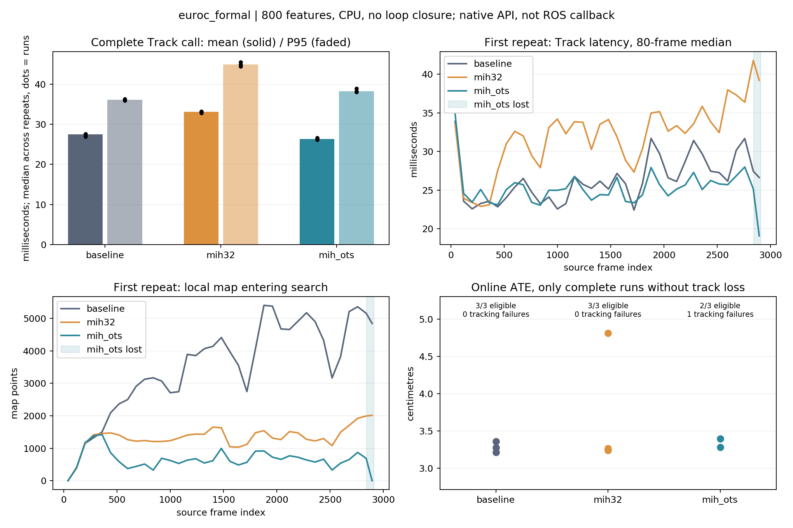
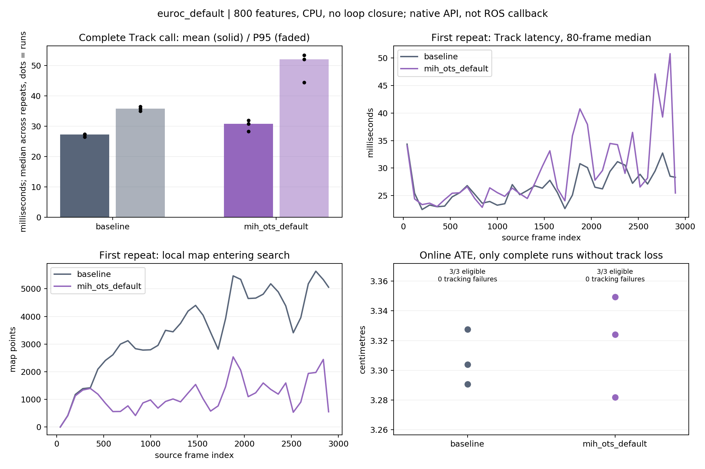
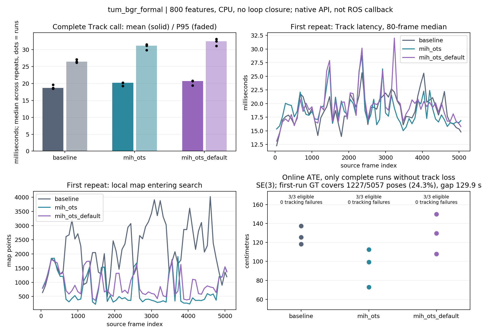

# GF-ORB-SLAM2 本地复现（GF01，2026-09-28）

**已完成 24 轮正式回放，共 89,193 帧。局部地图明显缩小，但在本机、这些数据和配置下，没有稳定复现论文的整体延时收益。**

GF 项目已下载、编译并实际回放，不是仅阅读论文。独立目录：`/home/ywl/Project/RDK_X5_orb_slam/gf_orb_slam2_repro_20260928`；源码在 `upstream/`，可重复构建和测试入口在 `harness/`。生产 ORB-SLAM3、RDK-X5 部署和板端地图均未修改。

## 为什么上一轮 LM01 没有获得预期收益

不能先认定 GF 在当前板端场景一定更快。上一轮 LM01 与本次复现已经给出三个更具体的解释。

1. **LM01 的 MP 限额没有实际削减工作。** 5000/6500/8000 是视锥、远点等过滤之后的新搜索候选上限；板端筛选实验最多只有 2025 个，native 最多 1439 个。这些档位没有触发截断，前面的点汇集、几何和快照成本仍然存在。KF 预算确实生效，不能将两者混为一谈。
2. **事务正确性有实测成本。** 长包 B1 的 snapshot P95 为 23.294 ms、commit P95 为 21.558 ms，KF 选择仅 0.599 ms；普通 OK 后段完整恢复/重试占比在三轮中为 7.41%～18.51%。这些阶段有包含关系，分位数不可相加。候选 Callback P95 为 146～149 ms，未达到 90 ms，也比同构建 off 更慢。减少局部对象数量不足以抵消新增费用。
3. **GF 筛选发生在另一个位置。** 当前公开实现的 Combined 路径先汇集共视点，再取它与外观哈希查询结果的交集，之后才做视锥和投影匹配；因此可省去被筛掉点的几何与匹配工作。但它仍扫描共视 KF 点槽，也要付哈希查询和维护成本，并不是直接从索引得到所有最终匹配。

LM01 的详细依据见 [上一轮完整报告](../local_map_budget_20260924/REPORT.md)，本次没有重新解释或覆盖其失败验收。GF 的在线选表是在关键帧上选择最多 32 张表的子集；LM01 的覆盖贪心是在每帧大量 KF 候选中选择工作集，频率和规模也不同。

此外，论文桌面单目平均延时与 RDK-X5 RGB-D Callback P95 不是同一实验。上一轮同构建 off 也存在输入缺口，不能把它称为已经通过的实时性基线。原论文报告 NewCollege 平均 18.3→12.2 ms，EuRoC 平均 18.4→15.7 ms；后者为多序列汇总，不能当成单条 V1_01_easy 的目标值。[原论文及实验定义](https://arxiv.org/html/1905.07797)

## 来源与实验边界

| 项目 | 实际执行 |
|---|---|
| 官方源码 | [ivalab/gf_orb_slam2](https://github.com/ivalab/gf_orb_slam2)，默认 `catkin` 分支，`2a60498cb889965bd5b4ab05c918ab28b433e882` |
| 本地源码补丁 | `39e794a`，分支 `repro/local-map-hashing-20260928` |
| 官方配置 | [ivalab/ORB_Data](https://github.com/ivalab/ORB_Data)，`f66cc0e176c50961542f312c8624ffffbd3b9acc` |
| 主机 | AMD Ryzen 7 4800H，8 核/16 线程，22 GiB RAM，Ubuntu 20.04 |
| 构建 | GCC 9.4，OpenCV 4.2，Eigen 3.3.7，Armadillo 9.800，Pangolin 0.9.4，CPU，`-O3 -march=native` |
| 调度 | `ondemand`，未绑核、未锁频；正式回放之间不并行编译或运行另一组 SLAM；有轻量日志检查和分析 |
| 数值库 | 系统 Armadillo 链接 ATLAS；设置 BLAS/OpenMP 单线程环境，但不声称这能控制 ATLAS 的全部内部线程 |
| 线程 | OpenCV 1 线程；保留后台 Mapping。OTS 信息矩阵按上游 `hardware_concurrency()` 使用本机 16 路任务，不是整个程序单线程 |
| 输入 | EuRoC V1_01_easy 原始 cam0，2912 帧；TUM freiburg2_large_with_loop，5057 对 RGB/depth |
| 固定参数 | 800 ORB features，8 层，scale=1.2，FAST=20/7；保留上游 2000-feature 单目初始化 |
| 保留算法 | 同一 GF 分支的普通 g2o Local BA、原匹配和跟踪阈值 |
| 隔离开关 | 关闭 Good Feature Matching、Good Graph、外部里程计、规划先验、GPU、viewer；不保存地图 |
| 回环 | 所有构建关闭回环，EuRoC 对应论文 VO 实验；TUM 是补充 RGB-D VO 对照，不是闭环 SLAM 验收 |

这里的 baseline 是 **同一 GF 分支关闭哈希**，不是另一份原版 ORB-SLAM2。上游 master 分支未包含所需哈希实现，故使用 catkin 代码并提供独立 CPU 驱动。当前发布代码也不是已确认的 2019 论文快照。

第一步不是跑项目所有默认开关：当前公开配置同时包含不同论文的模块，且默认哈希关闭。本次只检验用户关心的外观局部地图与在线选表，不能据此评价整个 GF 项目的所有模块。

## 本地适配与对照配置

[完整补丁](upstream.patch) 保留了所有改动：旧 OpenCV 头/常量与依赖查找适配、明确编译开关、初始化哈希查询向量及每帧标志。独立启用在线选表时，每帧清空其 scratch 点列表；上游原来只在 Good Feature Matching 分支中清空。增加选表完成状态、实际表数和耗时日志。未改检测器、描述子阈值、位姿优化或 BA 数学实现。上游自身已有不同于原始 ORB-SLAM2/当前 ORB-SLAM3 的阈值，本次只保证四组沿用同一份代码，不能把不同工程的绝对值直接相减。

| 模式 | 名义桶参数/每桶最多返回 | 查询表数 | 工作集 |
|---|---:|---|---|
| `baseline` | 无 | 无 | 共视局部地图 |
| `mih32` | 10/10 | 固定 32 | 共视与哈希交集 |
| `mih_ots` | 10/10 | 初始 8，在线最多 8，logDet 目标 80 | 同上 |
| `mih_ots_default` | 20/20 | 初始 8，在线最多 24 | 同上 |

**源码审计发现：当前 `Bucket::add()` 的容量淘汰代码已注释；构造参数 `max_feature_num_per_bucket` 只被保存/打印，不约束 deque 长度。10/20 实際约束查询返回数量，不能称为已实现容量上限的环形桶。** `insert()` 对已置 `mvbHashed` 的点跳过再插入，也没有完全复现论文中的重访刷新语义。此处没有擅自改算法；当前代码与论文原实现的关系仍是复现限制，不能直接把时延差异归因于这一个细节。性能矩阵结束后已运行独立容器诊断：名义 `MAX_BUCKET_SIZE=10`，向容器放入 25 个不解引用的空条目，`back(100)` 返回 25 个，`back(10)` 返回 10 个。该测试隔离验证存储/查询数量，不验证 MapPoint 生命周期，见 [结果](bucket_probe.json) 和 [测试源码](harness/test_bucket.cc)。本次没有完成 GF 原始指针与哈希并发访问的 sanitizer 审计，因此运行完成也不意味着它已满足当前 MEM18 的生命周期/并发契约。

第一组参数根据论文 III/IV 的桶大小 10、最多 8 表；论文 V 另有 `x=10` 表述，不能宣称不存在差异。第四组采用**当前上游较宽哈希参数**，不等于“整个 GF 默认配置”。共视集合不足 2000 点时保留上游不启用哈希的处理及初始化相关逻辑，不用 HashOnly 替换 Combined。

TUM 用 PNG 的 `DepthMapFactor=5000`，OpenCV BGR 输入的 `Camera.RGB=0`。最初沿用 ROS 的 `Camera.RGB=1` 后发现通道不匹配：该组 3 个完整轮次和 1 个中止轮次全部标为输入诊断，保留在 `runs/tum_formal/`，**不纳入正式结果**；修正后用独立 `tum_bgr_formal` 标签重跑。深度尺寸/数据类型/有效比例、时间配对检查见 [输入检查](tum_input_check.json)。

## 测量口径与质量判据

- 原始序列按时间戳 1×、顺序、不丢帧回放；处理超时就落后，不跳输入。因此“帧数完整”不等于 ROS 零丢帧或满足每帧实时期限。
- `track_ms` 是整个公开 `TrackMonocular/TrackRGBD` 调用，含选表、关键帧及后处理，排除驱动解码和等待。不是 ROS Callback 延时。
- 主表为每轮初始化后的统计量，再对三轮取中位数；后段固定为输入最后 25%，不随丢跟踪调整。原始全段统计、P99/max 和每轮数据也保留。
- 任何初始化后 non-OK 都导致该轮跟踪门失败。失败配置的原始耗时仍报告，但不能把快速 LOST 帧当作收益；ATE 汇总仅使用完整且无丢跟踪轮次，并注明数量。
- EuRoC 在线轨迹一次全局 Sim(3) 对齐；RGB-D 用单位尺度 SE(3)，1 秒 RPE，时间匹配容差 20 ms，真值缺口不插值。EuRoC 相机真值已用 `T_WB × T_BC` 独立核对，最大位置差约 8.54e-8 m。
- TUM 真值中间有约 129.865 秒缺口，必须看有效关联数，不能将其 ATE 解释为全段精度。
- 上游 `match_ms` 包含工作集更新与搜索；`hash_field_ms` 被整个局部点更新耗时覆盖，**不是纯哈希查询耗时**。`pose_stage_sum_ms` 是若干阶段之和，不是实测 pose 发布时延。

论文定义接收图像到发布位姿的延时，使用 10 次重复，并排除发生跟踪丢失的配置；本次是原生 API 的 3 次重复及两个数据序列。这里没有声称完整复现其 11 条 EuRoC/43 分钟 NewCollege 实验，也不据此否定论文结论。[论文实验部分](https://arxiv.org/html/1905.07797)

## EuRoC 第一组：共视、32 表、在线选表

全部 9 轮处理 2912/2912 帧，顺序 B-F-O / F-O-B / O-B-F。在线选表的一轮从索引 2844 起连续 68 帧 LOST，另两轮正常。

| 模式 | 无丢跟踪轮数 | Track 平均 ms | P95 ms | P99 ms | 后 25% P95 ms | 有效 ATE 中位数 cm |
|---|---:|---:|---:|---:|---:|---:|
| 共视基线 | 3/3 | 27.521 | 36.100 | 54.532 | 38.725 | 3.279 |
| MIH 固定 32 表 | 3/3 | 33.083 | 44.889 | 58.974 | 49.548 | 3.268 |
| MIH 在线最多 8 表 | 2/3 | 26.343 | 38.196 | 54.774 | 42.848 | 3.338，仅 2 轮 |

在线选表原始平均耗时约下降 4.3%，P95 上升 5.8%，后段 P95 上升 10.6%；且未通过三轮跟踪门。固定 32 表平均耗时增加 20.2%。两者均未得到“稳定且整体更快”的结果。失败起点在运动模型/参考 KF 阶段，不能仅凭它存在就断言某个具体局部点被删是根因。

| 模式 | 平均局部 MP | Local Map 平均 ms | 更新＋搜索平均 ms | 优化＋点统计平均 ms | 后处理平均 ms |
|---|---:|---:|---:|---:|---:|
| 共视基线 | 3688 | 9.448 | 7.540 | 1.906 | 0.282 |
| 固定 32 表 | 1321 | 14.900 | 13.174 | 1.710 | 0.287 |
| 在线最多 8 表 | 699 | 7.073 | 5.653 | 1.413 | 1.482 |

表内为各轮均值的中位数。在线选表的局部点约少 81%，局部阶段约快 25%，但整次调用并未获得相同比例的收益。固定32表局部点少、更新/搜索却更慢，说明哈希开销是真正要测量的部分。

第一轮在线选表 257 次更新全部完成，表数中位数 3、P95=8；单次选表平均约 0.369 ms。它之外还有关键帧的额外匹配、信息矩阵构建等费用，不能把这 0.369 ms 当作完整额外开销。

局部地图变小还伴随全局建图变化。第一组基线最终 158～163 KF、5997～6152 MP；固定32表为 236～254 KF、9868～10685 MP。普通 Local BA 有计时的调用次数从每轮 328～345 增至 481～504，平均整进程 CPU 从 1.37～1.41 核增至 1.52～1.55 核，RSS 峰值从 717～732 MiB 增至 824～841 MiB。在线8表 RSS 为 757～760 MiB。所有这些轮次进程 Swap=0。

这是相关的工作量变化，尚未通过独立消融证明因果。BA 记录没有可靠完成/中断字段，本次只报告调用墙钟和图规模，不把记录数称为“成功完成次数”。资源 CPU 覆盖启动到退出，并非精确 Tracking 区间 CPU；短暂信息矩阵线程可能未被 2 秒采样捕获。



[机器结果](euroc_formal/analysis.json) · [原始数据索引及 SHA256](euroc_formal/raw_index.json)

## EuRoC 第二组：补测上游较宽哈希参数

此组与第一组顺序隔离；新增第四个构建后核对原三组二进制与 g2o/DBoW2 哈希未变。重新运行本组 baseline，A-B / B-A / A-B，避免跨批次直接作比。

| 模式 | 无丢跟踪轮数 | Track 平均 ms | P95 ms | P99 ms | 后 25% P95 ms | ATE cm |
|---|---:|---:|---:|---:|---:|---:|
| 本组共视基线 | 3/3 | 27.262 | 35.791 | 57.394 | 39.232 | 3.304 |
| 在线最多 24 表、桶 20 | 3/3 | 30.814 | 52.042 | 70.688 | 61.721 | 3.324 |

较宽参数三轮均稳定，但平均耗时增加约 13.0%，P95 增加约 45.4%，后段 P95 增加约 57.3%。放宽参数没有同时实现稳定性与加速。



[机器结果](euroc_default/analysis.json) · [原始数据索引及 SHA256](euroc_default/raw_index.json)

## TUM RGB-D 补充对照

正式九轮全部处理 **5057/5057**，输入索引连续、时间戳递增、字段有限，初始化后 non-OK=0。顺序为 B-O-W / O-W-B / W-B-O，颜色配置错误的旧矩阵已排除。

| 模式 | 无丢跟踪轮数 | Track 平均 ms | P95 ms | P99 ms | 后 25% P95 ms | 可关联部分 ATE m |
|---|---:|---:|---:|---:|---:|---:|
| 共视基线 | 3/3 | 18.705 | 26.418 | 37.756 | 28.604 | 1.256 |
| 在线最多 8 表 | 3/3 | 20.164 | 31.134 | 37.793 | 31.583 | 0.994 |
| 在线最多 24 表 | 3/3 | 20.709 | 32.459 | 41.678 | 30.993 | 1.296 |

在线8表平均耗时增加 **7.8%**、P95 增加 **17.9%**；较宽参数平均增加 **10.7%**、P95 增加 **22.9%**。这组数据不支持“GF 的局部地图哈希一定比共视基线实时性更好”。

局部阶段确有收益：三轮中位数的平均局部 MP 为 2209→783，Local Map 平均 6.521→5.281 ms；但后处理平均 0.366→2.399 ms，抵消了前面的节约。最终 KF 由 916～925 增至 1075～1088，MP 由 28073～29055 增至 33425～36011。这些都是运行后的整体反馈，未做独立因果消融。

**精度不能只看无丢跟踪。** 每轮只有 1227/5057 个在线位姿能关联真值（24.3%），中间约 129.865 秒没有真值；ATE 达到米级。上述表格是这一可关联部分的单位尺度 SE(3) 误差，不是全段精度通过结论。1 秒 RPE 平移三轮中位数分别 0.0973/0.0785/0.0830 m，旋转 1.2023/1.0422/1.0998°。窄参数在现有真值片段上的误差更低，但没有换来延时收益，也没有验证闭环。



[机器结果](tum_bgr_formal/analysis.json) · [原始数据索引及 SHA256](tum_bgr_formal/raw_index.json) · [24 轮明细 CSV](run_summary.csv) · [各组相对变化](comparison_summary.json)


## 证据、复现和后续取舍

可执行文件为独立目录 `build/replay_{baseline,mih32,mih_ots,mih_ots_default}`。每轮目录保存 `run.json`、逐帧 CSV、在线/关键帧轨迹、后端日志、控制台和资源采样。跟踪之前冻结配置、输入索引、驱动和二进制哈希；不同版本驱动/配置放在 `provenance/`，失败与中止记录也保留。

复现命令（在独立目录执行，已有 tag 不覆盖，重新运行时使用新 tag）：

```sh
python3 harness/prepare_inputs.py --check-existing
cmake -S harness -B build
cmake --build build --target replay_baseline replay_mih32 replay_mih_ots replay_mih_ots_default -j3
python3 -m unittest discover -s harness -p 'test_*.py' -v
python3 harness/run_matrix.py --dataset V1_01_easy --modes baseline mih32 mih_ots --repeats 3 --tag my_euroc
python3 harness/analyze.py runs/my_euroc
python3 harness/run_matrix.py --dataset V1_01_easy --modes baseline mih_ots_default --repeats 3 --tag my_euroc_wide
python3 harness/analyze.py runs/my_euroc_wide
python3 harness/run_matrix.py --dataset tum_large --modes baseline mih_ots mih_ots_default --repeats 3 --tag my_tum
python3 harness/analyze.py runs/my_tum
python3 harness/export_summary.py runs/my_euroc runs/my_euroc_wide runs/my_tum
```

编译与计时回放按顺序执行，不能同时运行。初次建立索引可去掉 `--check-existing`，脚本会拒绝覆盖已有文件。路径和主机依赖见 [README](README.md)；源码、二进制、配置清单见 [source manifest](source_manifest.json)、[build manifest](build_manifest.json)。三项精度工具测试已通过：已知尺度/旋转/平移恢复及 RPE、RGB-D 禁止拟合尺度、真值缺口不插值。早期 400 帧烟测与编译并行，只作功能检查，未用于性能表。

本次证据支持先解决 LM01 的快照/提交费用及筛选位置，不能仅凭论文速度图直接移植 MIH 并预期 RDK-X5 达标。MIH 仍值得作为有独立开关的后续实验，但须同时计入查询、索引维护、关键帧后处理和跟踪恢复成本。Good Feature Matching、Good Graph、NewCollege 长时闭环、RDK-X5 ARM 移植不在本次已验证范围。

Git：源码适配提交 `39e794a`；IDE 初始复现检查点 `9fa86c71`。最终证据提交可由本文件的 Git 历史定位。生产 LM01 继续默认关闭。本次通过的是下载、构建与实测证据交付，**不是论文全矩阵复现成功，也不是生产实时性/精度验收通过**。
