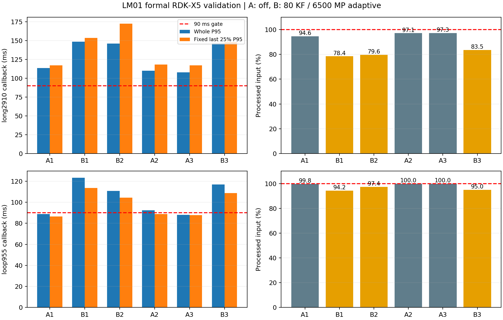

# LM01 活动局部地图：实现与验收报告

**最终结论：实现、分阶段提交和验证归档已完成，但实时性/质量验收失败，功能默认关闭。** 三档均未准入；保留全部失败证据，未替换旧交付。冻结事务、统计、并发与图数值等局部测试通过，不等同于完整系统或生产验收通过。

## 实施范围与来源

实际修改位于 `/home/ywl/Project/RDK_X5_orb_slam/debug_branches/rgbd_memory_lifecycle` 及独立 `core/` 仓库，两者分支均为 `perf/tracking-local-map-budget`。本 IDE 仓库保存工具来源、文档和证据，没有把其 XFeat core 用作 RDK 基线。冻结 MEM18/perf20 和旧交付保持保留；候选只部署在 `/userdata/rgbd_localmap_budget_20260924`。

修改前已分别提交三个仓库的现有源码、配置、文档和工具。生成的 bag、地图、构建目录及大型日志保持本地，保存清单/哈希，没有把整个未跟踪 `memory/` 目录直接加入 Git。

| 阶段 | core 提交 | outer 提交 | 实际内容/结论 |
|---|---|---|---|
| C0 | `d80009e9` | `3d38e373`、`eb05fe4` | 保存原修改；IDE `4aabed58` |
| C1 | `9e100300` | `774641e7` | 事务、纯投影、私有匹配和提交验证 |
| C2 | `6f1d6cf3` | `3b51d770` | KF 硬预算、一次完整重试、身份同步 |
| C2.1 | `185ed790` | `cf93c46` | 提升前去重、连续增量容器；板端仍失败 |
| C3 | `dfb2f976` | `0eb0c1f` | 类型化地图事件、双健康状态、恢复试探 |
| C4 | `b7ebd840`、`64d073fd` | `6c495b5`、`c0ddab1` | coverage 实测未晋升，默认 votes |
| C5 | `906d870f`、`0f735dd9` | `9188413`、`d61522a` | MP/机会统计/出生批次；三档全部未准入 |
| C6 计时 | `05e83e55` | `9feff3c` | 新增 BA 调用线程 CPU 计时，正式矩阵 |

C5 收尾文档提交晚于 C6 计时提交；功能源码以 manifest 中的文件哈希和冻结二进制为准。最终收尾 core **be52247f**、outer **9c43a6c**；完整提交链见 [COMMIT_HISTORY.json](COMMIT_HISTORY.json)，来源/产物/回退索引见 [DELIVERY.json](DELIVERY.json)。

## 已实现的行为

| 模块 | 关键文件（runtime core） | 行为 |
|---|---|---|
| 事务执行 | `LocalTrackingAttempt.{h,cc}`、`TrackingLocalMap.cc` | 在 UpdateLocalMap 前捕获入口；尝试持有独立 Frame/局部集合/缓存/增量；最多一次从相同输入的完整重试；仅提交最终结果 |
| 几何与匹配 | `LocalMapProjection.h`、Frame/ORBmatcher/Optimizer 适配 | 影子与实际路径共用几何；保留预测尺度、视角、右坐标与原距离语义；匹配读取 scratch |
| KF 选择 | `LocalMapBudget.{h,cc}` | 安全集合、真正上限、votes；coverage 使用位集/popcount，记录饱和与决胜因素；选择顺序与遍历顺序分开 |
| MP 选择 | `LocalMapPointBudget.{h,cc}`、`LocalMapGrid.h` | 已有关联受保护；几何/远点过滤后按去畸变 24×16 网格与三层 Z 分配；评分使用有效唯一 KF 数，归一化到 8 |
| 控制 | `LocalMapController.h`、`LocalMapEvents.{h,cc}` | 普通 BA 不续期；loop/GBA/merge/reset/switch 显式版本；预算失败与最终健康分开，扩容/冷却/下降试探 |
| 并发 | `LocalTrackingIdentity.h`、MapPoint/KeyFrame 接口 | 地图更新锁→身份屏障→对象锁；快照释放 MP 锁后访问 KF；验证所有目标再提交增量，不回滚共享计数 |
| 观测与诊断 | `LocalMapLifetime.{h,cc}`、`LocalMapDiagnostics.{h,cc}` | 独立选择/查询诊断、实际关联/残差/信息矩阵、出生批次、退出原因、墙钟/数据集等待时间 |

上游同帧 `mnLastFrameSeen` 跳过语义与本尝试去重独立。`legacy` 保留选中工作集内原统计行为；`attempted` 按唯一 MP 提交本次机会增量，已有有效关联也有 visible，保证本次 `0≤ΔFound≤ΔVisible≤1`。完整重试不切换统计定义。兼容路径保留原先发布更新前 Atlas 引用点的时序。

**实际同步成本必须计入结论。** 身份屏障覆盖尝试及提交，防止退休/替换/转图与最终约束产生不一致；普通描述子/法向/观测元数据仍可更新，尝试使用冻结值。它不是无成本的强句柄替换，并可能增加后端等待。完整 System 的进度保证不能由受控 TSan fixture 推断。

纯 RGB-D、ORB 二进制描述子范围内启用实验。特征 700、5 层、3 workers、输入队列 8/8/10、原匹配门槛及全局地图生命周期保持原配置；没有实施 MIH、预算 BA 或删全局地图。

## 功能与并发验证

- 全新 host/ARM node、core、原 probe、新 local-map probe 成套构建；源文件稳定性检查和实际加载库哈希留档。
- 原 27 项 ARM probe 通过，固定图最大数值差 `7.1e-15`，容差 `1e-12`。
- 两种统计策略的“直接完整”与“预算丢弃后完整”比较通过：实际 MP—特征关联、outlier、参考 KF、顺序、位姿/缓存/增量；另有 legacy 匹配兼容、同帧跳过、失效对象拒绝、统计一次提交测试。
- KF126 候选硬上限、强制集合覆盖饱和、竞争关联、MP 网格/深度/年轻保留、普通 BA 不续期、预算低内点不能被完整结果洗掉等 fixture 通过。
- 1170 事件的出生/观测/替换/转图/退休并发 fixture 通过；出生批次分析器 6 项测试通过。轨迹评估 SE(3)/时间关联合成测试 3 项，产物归属/变更/符号链接拒绝检查通过。
- ASan/UBSan/LSan **局部 fixture** 通过；Boost 1.71 两类既有 UBSan 行为仅对对应系统头文件排除。完整并发 fixture 的 TSan 数据竞争检查通过；Clang10 死锁检查有 64 把同时持锁的工具限制，完整 fixture 关闭该检查，12 点实际事务另行启用并通过；小测试仅抑制既有 GDAL 启动锁报告。详细规则和原始失败日志保留。
- **继承的完整 System LSan 失败没有修复，也没有改报为通过。** 原有旧地图定位失败、长时间运行、真实连续相机输入、完整惯性/双目路径不在本次通过声明内。

## 筛选结果与算法决策

原 perf20 两轮长包仅处理 2840/2865 对（应为 2910），Callback P95 为 110.788/105.967 ms；新 off 桥接为 2809/2839 对、114.042/110.611 ms。原基线也未满足本次 90 ms/零丢帧要求，因此不能把相对改善称为达标。

### KF 与 coverage

C2.1 固定 KF80：2490/2910、non-OK0、P95=123.895 ms、固定后 25%=126.206 ms。C3 三档自适应 KF96/80/64 的 P95=143.660/136.285/129.535 ms，全部失败。

C4 两轮对照：votes 的 P95=120.518/123.913 ms，coverage=142.096/141.289 ms。四轮 native 均完整 2910 且 OK；coverage 新匹配召回只提高 0.029～0.052 个百分点，低于 0.5 pp 晋升要求，选择成本约 1.9 ms 对 0.23 ms。板端选择成本约 7.6 ms 对 0.57 ms。**coverage 保留实验开关，votes 保持默认。** 详见 [C4 决策](c4/DECISION.md)。

### MP 与机会统计

| C5 板端配置 | 处理/2910 | non-OK | 全段 P95 ms | 固定后 25% P95 ms |
|---|---:|---:|---:|---:|
| KF80 legacy、无 MP 截断 | 2436 | 35 | 133.027 | 137.412 |
| KF80 attempted、无 MP 截断 | 2358 | 35 | 134.134 | 138.264 |
| KF80 attempted、MP6500 | 2443 | 0 | 133.633 | 139.117 |
| 自适应 KF96/MP8000 | 2158 | 0 | 155.713 | 161.387 |
| 自适应 KF80/MP6500 | 2446 | 70 | 136.946 | 144.254 |
| 自适应 KF64/MP5000 | 2434 | 0 | 137.711 | 155.177 |

**这六轮的 MP 预算均未触发截断，过滤后候选最多 2025。** native MP6500 轮最多 1439；局部汇集点可以很多，但等待匹配的有效候选少得多。不能由这些结果宣称网格 MP 策略降低了实际工作量，也不为制造收益而擅自缩小到计划之外的生产档位。64 点压力配置只验证真正绑定时的硬上限和年轻名额分配。

四轮 native 统计消融均 2910/2910 OK；影子整体召回 99.959%、新增 99.877%、实际关联 99.936%，新增召回 P5=98.708%。这些是冻结名单/匹配诊断，不等同于 TUM 轨迹验收。

新生 MP 第二/第三个有效唯一 KF 观测与 2/3/5 个同地图 KF 后存活：native 相对 legacy 最差下降 0.122 pp；板端筛选均在 1 pp 内，未触发 5 pp 拒绝门。10% 年轻点长包消融的条件未触发；其机制已由真正绑定预算的压力测试覆盖。不同 KF 档位比较仅作筛选，不作为单一统计定义的因果证明。观察窗口未结束和转图按右删失处理；上游 KF-ID 年龄另列。详见 [C5 机器结果](c5/completed/board_matrix.json)。

## C6 正式矩阵与最终判定

**生产准入：FAIL；三档均不启用，默认 off。** 长包六轮、闭环六轮、TUM 六次尝试、故障六轮及保存重载已执行并保留全部结果。TUM 有一次卡住后中止，其余五次完整处理 5057 对，不能写成六次均完成。机器判定见 [acceptance.json](c6/acceptance.json)，所有分位数、工作集、CPU/内存、队列、图规模及空间证据见 [formal_details.json](c6/formal_details.json)。

A=同构建 off，B=平衡档 votes、KF80/MP6500、attempted、自适应；B 是固定的诊断档，不是已准入配置。顺序为 A-B/B-A/A-B。所有板端性能轮均为 1×、700 features、5 层、3 workers、队列 8/8/10；普通轮关闭 Atlas 保存。两组共同开启生命周期日志及后端计时，B 的额外尝试/选择/提交日志成本也计入回调。六轮闭环共同增加同样的现有轨迹话题订阅。输入缺口使不同轮次处理的帧集合不同，因此以下比较是整机结果，不能解释为同帧算法加速比。

### 长包：逐轮回调结果

| 轮次 | 处理/应处理 | non-OK | 地图数 | P50 ms | P95 ms | P99 ms | max ms | 固定后 25% P95 ms |
|---|---:|---:|---:|---:|---:|---:|---:|---:|
| A1 | 2752/2910 | 35 | 2 | 87.439 | 113.661 | 131.104 | 4889.398 | 117.327 |
| B1 | 2282/2910 | 0 | 1 | 112.848 | 148.547 | 166.503 | 421.279 | 153.786 |
| B2 | 2316/2910 | 36 | 2 | 110.108 | 146.167 | 178.995 | 249.530 | 172.585 |
| A2 | 2825/2910 | 0 | 1 | 85.827 | 110.157 | 124.671 | 325.857 | 118.275 |
| A3 | 2831/2910 | 0 | 1 | 85.247 | 108.010 | 121.448 | 263.661 | 117.039 |
| B3 | 2431/2910 | 111 | 4 | 100.759 | 146.365 | 183.116 | 402.154 | 148.022 |

### 闭环包：逐轮回调结果

| 轮次 | 处理/应处理 | non-OK | 地图数 | P50 ms | P95 ms | P99 ms | max ms | 固定后 25% P95 ms |
|---|---:|---:|---:|---:|---:|---:|---:|---:|
| A1 | 953/955 | 0 | 1 | 66.791 | 88.730 | 104.521 | 160.057 | 86.557 |
| B1 | 900/955 | 0 | 1 | 86.734 | 123.417 | 137.179 | 184.241 | 113.693 |
| B2 | 930/955 | 0 | 1 | 85.799 | 110.799 | 128.375 | 152.886 | 104.420 |
| A2 | 955/955 | 0 | 1 | 68.189 | 92.300 | 105.542 | 254.271 | 88.810 |
| A3 | 955/955 | 0 | 1 | 67.213 | 87.960 | 108.951 | 146.022 | 87.744 |
| B3 | 907/955 | 1 | 1 | 86.773 | 116.878 | 130.610 | 228.408 | 108.722 |

候选六轮全部失败；Callback P95、固定后 25% P95、P99 相对基线中位数和输入完整性均未通过。正常长包 B2/B3、闭环 B3 还有 non-OK；长包 B2/B3 出现地图分裂。对照长包同样全部存在输入缺口。全部主机 RGB/depth 输入序号完整，缺口发生在板端处理链，不能用成功处理帧的分位数掩盖它。

长包 A1 最大回调 4889.398 ms，其中 Local Map 4850.036 ms、局部搜索 4831.592 ms；之后出现 46 个序号的缺口。根因没有得到线程级定位。按预先规定的 max 门槛公式，长包上限因此为 5378.338 ms，候选的 max 数值门通过，但这不表示具有可接受的最坏时延。首个失败前后完整窗口见 [tracking_failure_windows.json](c6/tracking_failure_windows.json)。B2 进入完整 RECOVERY 后仍出现 29/41 内点不足；其他失败部分发生在进入局部跟踪之前，不能一概归因为 MP 被裁掉。


[下载 PDF 图](c6/formal_comparison.pdf)。

### Local Map、规模与恢复占比

下表为全段统计。完整恢复帧允许超过正常预算，因此工作集 P95 不等同于正常档上限；所有有界尝试的 KF/MP 硬上限检查和最终提交检查均通过。

| 数据/轮次 | KF P95 | MP P95 | Local Map P50 ms | P95 ms | P99 ms | max ms |
|---|---:|---:|---:|---:|---:|---:|
| long2910/A1 | 230.4 | 12740.0 | 34.578 | 54.942 | 68.567 | 4850.036 |
| long2910/B1 | 120.0 | 8904.3 | 61.164 | 90.646 | 107.767 | 190.748 |
| long2910/B2 | 120.0 | 8706.5 | 60.319 | 90.732 | 115.587 | 176.954 |
| long2910/A2 | 210.8 | 11470.0 | 33.696 | 51.607 | 63.080 | 117.652 |
| long2910/A3 | 185.5 | 10717.5 | 31.384 | 48.734 | 57.405 | 145.609 |
| long2910/B3 | 113.0 | 8636.5 | 47.452 | 89.485 | 116.076 | 332.002 |
| loop955/A1 | 129.0 | 6168.2 | 24.966 | 43.960 | 49.128 | 69.097 |
| loop955/B1 | 100.0 | 6093.2 | 45.668 | 78.065 | 87.344 | 104.060 |
| loop955/B2 | 111.0 | 5094.1 | 45.508 | 65.715 | 71.691 | 110.288 |
| loop955/A2 | 125.0 | 6357.6 | 26.484 | 44.010 | 51.695 | 62.021 |
| loop955/A3 | 129.0 | 6190.6 | 26.160 | 42.237 | 48.808 | 62.969 |
| loop955/B3 | 115.0 | 5493.5 | 44.815 | 72.006 | 77.950 | 85.208 |

| 候选轮次 | 完整路径总占比 | 普通 OK 后段完整/重试占比 | 最长连续完整调用/墙钟跨度 | 完整重试次数 |
|---|---:|---:|---:|---:|
| long2910/B1 | 13.20% | 18.51% | 34 次 / 5.310 s | 4 |
| long2910/B2 | 11.57% | 12.38% | 43 次 / 7.670 s | 7 |
| long2910/B3 | 15.30% | 7.41% | 30 次 / 4.211 s | 3 |
| loop955/B1 | 10.46% | 0.00% | 34 次 / 3.044 s | 0 |
| loop955/B2 | 22.82% | 6.93% | 28 次 / 2.953 s | 3 |
| loop955/B3 | 17.90% | 0.00% | 47 次 / 5.475 s | 0 |

总占比分母为实际进入局部跟踪的调用；后段按固定源序号最后 25% 划定，普通 OK 仅排除明确的初始化/事件/重定位安全窗口，不排除预算恢复和冷却。墙钟跨度来自连续回调记录，未进入局部跟踪的上游失败会截断驻留段。长包三轮均超过 1% 回退门，恢复状态的长期占用不能算作预算生效。

以下列出长包 B 的阶段 P95。snapshot 是其他阶段的子集，不能把各列相加；最终回调是总成本的权威值。

| 轮次 | KF 选择 | snapshot | update | search | pose | commit | 身份锁等待 |
|---|---:|---:|---:|---:|---:|---:|---:|
| B1 | 0.599 | 23.294 | 37.800 | 7.921 | 16.012 | 21.558 | 0.002 |
| B2 | 0.482 | 23.552 | 39.516 | 7.800 | 13.222 | 20.247 | 0.002 |
| B3 | 0.476 | 23.460 | 38.487 | 8.032 | 12.778 | 19.634 | 0.002 |

C6 的 MP 上限同样没有触发截断，机会统计仍参与跟踪/后端反馈。主要费用在点汇集、快照、优化和提交，不在一个已经不绑定的 MP Top-N 筛选。提交锁等待单独计时，锁操作和验证本身仍包含在 commit 内；不能把等待列接近零解释为同步免费。

### BA、CPU、内存与输入队列

| 长包 B | Local BA 完成/执行 | 墙钟 P95/max ms | 调用线程 CPU P95/max ms | 整进程 CPU P50（核） | 峰值 PSS MiB |
|---|---:|---:|---:|---:|---:|
| B1 | 6/112 | 1392.397/8699.075 | 1337.631/8643.045 | 2.63 | 984.5 |
| B2 | 4/133 | 1164.192/14598.325 | 1080.074/14509.339 | 2.67 | 997.4 |
| B3 | 7/162 | 828.673/11104.066 | 759.019/11013.758 | 2.63 | 990.4 |

BA 的 CPU 长尾接近墙钟长尾，说明存在实际计算负担；这三轮 Local BA 调用线程合计占整进程 CPU 约 6.8%～7.5%，不含建点、剔除、回环/GBA 或帮助线程，不能把所有后端成本都算成这一比例。三轮 Local BA 候选 MP P95 分别为 6099/6642/5217、实际图顶点 P95 为 6433/6776/5473、边 P95 为 45643/47084/40013。优化/固定 KF 及完成/中断的完整分布均在机器结果中。

原 visual LocalBundleAdjustment 未填写 `num_MPs` 输出参数，导致旧计时表 `lba_map_points` 恒为零。分析工具已明确标为不可用，并独立读取 MemoryStats 中的候选点数和真实图顶点/边数，未把零当作真实图规模，也未伪造逐次 CPU—图记录关联。

资源采样为整进程 user+system CPU/墙钟，包含启动与收尾。回调 CSV 相对首回调计时，资源 CSV 使用绝对 monotonic 时钟；缺少共同起点，精确回调区间 CPU 标为不可用。所有正式轮进程 Swap=0、系统 pswpin/pswpout 增量=0、无新增 OOM-kill；长包 A1 和闭环 B1 各有 1 次 major fault。PSS/RSS、温度/调频及 LocalMapping 队列深度/等待分布均保留。细粒度生命周期日志的交互开销未做独立开关消融；C2 在尚无该日志时也已失败，不能据此假定去掉日志就会达标。

### 闭环轨迹与真值

六轮闭环均检测到一次预期回环，GBA 均完成写回、结束和 join，无该日志记录的异常阶段。六轮已有 raw/continuous 轨迹话题均覆盖全部 OK 回调，时间戳严格递增、位姿有限、四元数归一化；步长、旋转、范围、路程与首尾距离见 [轨迹检查](c6/pose_sidecars/analysis.json)。这是在线输出/分布检查，不是 S316 真值精度或 GBA 后全帧轨迹验收。

TUM 使用 SE(3) 对齐（尺度固定 1）、20 ms 唯一时间关联、1 秒 RPE。真值有 **129.865 秒中段缺口**，通常仅关联约 1227/5057 对。多地图轮的整体在线 ATE 仅作诊断；不能跨重置把坐标系当作同一条合格轨迹。

| TUM 轮次 | 完整落盘帧/5057 | non-OK | 最大地图数 | 最终修正 ATE m | 1 s RPE 平移 m / 旋转 ° |
|---|---:|---:|---:|---:|---:|
| off_1 | 4693 | 180 | 3 | 不可用 | 不可用 |
| candidate_1 | 5057 | 0 | 1 | 0.122 | 0.088/1.009 |
| candidate_2 | 5057 | 222 | 2 | 不可用 | 不可用 |
| off_2 | 5057 | 92 | 2 | 不可用 | 不可用 |
| off_3 | 5057 | 92 | 2 | 不可用 | 不可用 |
| candidate_3 | 5057 | 0 | 1 | 0.141 | 0.075/0.916 |

off1 在合并处长期无帧进展后中止；4693 是完整落盘行数，受缓冲区影响不是已执行回调的精确计数。其最终轨迹缺失；candidate2、off2、off3 的修正轨迹时间戳不递增，评估器拒绝。没有有效的三轮对照中位数，**5% 精度门不可认定通过**。candidate1/3 的单轮好结果不能替代整组。初始 C5 二进制的另六轮 TUM 负面结果也保留在 `c6/initial_tum/`。

合并采样栈和 C0 相同清理循环的审计见 [MERGE_TIMEOUT.md](c6/MERGE_TIMEOUT.md)。参考 KF 清理不推进是待独立冻结复现的机制，尚不能断言根因已证明或新增同步对触发时机没有影响。

### 故障、出生批次、保存重载与空间

最终遮挡/缺口回归保留 295 对（从 300 对中去掉 5 对，另将 15 帧 RGB 置黑，深度不变）：off/candidate 分别有 55/52 帧 non-OK，均发生地图分裂、最终连续 50 帧恢复 OK。重定位曾被接受，但“恢复且保留原地图”的强门没有通过。Reset 和主动地图切换的 A/B 各 240 帧全部 OK；Reset 更新代次、地图切换为预期的两张地图，候选提交失败均为零。见 [故障结果](c6/final_faults/results.json)。

出生批次的匹配统计消融门通过；C6 相对 C5 KF-only legacy 的描述性比较最大下降 0.538 pp，未超过 5 pp。由于 C6 自适应/闭环历史不同，这一对比不能作单因素因果结论；不能用出生批次通过覆盖整机跟踪失败。

保存轮 120/120、全部 OK；保存地图 8,914,885 字节，SHA256 `d861ec4024c290b9aaa0cbfa9e2980a2cf9740963725e5effae10dd7181d9c88`。重载确实使用已有地图、未新增地图，已处理 101 帧全部 OK，但缺少 19 对输入，所以保存重载联合门 **FAIL**。两轮均正常退出；地图回传与 SHA 校验后才删除板端登记文件。主机保留可复查副本，清理记录见 [save_reload/results.json](c6/save_reload/results.json)。

正式 12 轮最小可用空间 9,799,389,184 字节（约 9.13 GiB），普通性能轮 Atlas 产物为 0。保存重载清理后核验可用空间 9,775,378,432 字节（约 9.10 GiB），实验 SLAM 进程和未清理登记地图均为 0。没有删除旧交付、冻结 MEM18/perf20 或未登记文件。

## 复现、空间与回退

在 runtime outer 执行，使用新阶段名/目录，避免覆盖已冻结证据：

```bash
bash memory/tools/build_localmap_host.sh replay_lm01
python3 memory/tools/freeze_localmap_host_build.py replay_lm01 FROZEN
bash memory/tools/build_arm.sh --output build-arm-replay-lm01 --localmap
python3 memory/tools/run_localmap_board_matrix.py memory/build-arm-replay-lm01 PLAN.json OUTPUT --probes --lifetime
LM01_DETAILED_TIMING=1 python3 memory/tools/run_localmap_tum_matrix.py FROZEN OFF.yaml CANDIDATE.yaml OUTPUT
LM01_DETAILED_TIMING=1 python3 memory/tools/run_localmap_fault_matrix.py FROZEN OFF.yaml CANDIDATE.yaml OUTPUT
python3 memory/tools/run_localmap_save_reload.py memory/build-arm-replay-lm01 CANDIDATE.yaml UNIQUE_LABEL --port UNUSED_PORT
python3 memory/tools/evaluate_localmap_acceptance.py BOARD_OUTPUT TUM_OUTPUT acceptance.json --supplementary supplementary.json
```

`PLAN.json` 必须复制 `c6/formal_plan.json` 后修改独立 stage/name/port，配置保持相同；冻结目录的二进制由其 `manifest.json` 逐项校验。最终已执行命令、实际 manifest 和退出码见 C6 证据。构建期间不编辑来源文件，运行期间不修改 runner；每个板端 round 再冻结脚本与配置。

空间协议：bag 留主机；每轮启动要求可用空间≥max(4 GiB, 2×预计产物+1 GiB)，每 5 秒检查，低于 2 GiB 停止输入并优雅退出。仅指定保存重载轮登记 `.osa`；回传和 SHA256 检查成功后，按 manifest 删除该轮登记地图，拒绝通配、跨路径和符号链接清理。回传失败则停止后续轮次。

配置回退：`RGBD.LocalMapMode: "off"`；删除可选实验配置也默认 off。完整二进制回退应使用冻结 perf20 的配套 node/core/config/vocab，不混用新旧库。off 只关闭活动局部地图算法，仍包含本分支的同步/诊断接口；不能声称它与旧二进制逐字节相同。本轮没有替换旧交付或部署为生产默认。

## 后续条件

本轮不足以支持“限制局部地图即可达到板端后段实时性”的结论。首先定位汇集、快照/提交、同步及后台 BA 的实际费用；MP 截断不绑定时，继续调它不会省掉前置扫描。需要外观检索时，查询应先于 KF 点槽扫描；GF-ORB-SLAM2 Combined 先汇集再求交，不能直接照搬后声称省掉该扫描。预算化 Local BA 另立阶段，按 RDK CPU/图规模标定并保留全局地图与取消/写回契约。完整调研和可实施步骤见 [后续方案](FOLLOWUP.md)。
