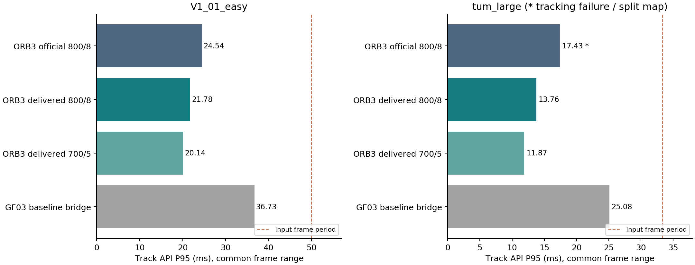

# GF04：官方 ORB-SLAM3 与已交付加速版实时性对照

2026-09-28。本轮主 baseline 已改为官方 ORB-SLAM3，加入真正交付的加速版；
每个配置/场景只跑一轮正式测试。完成 **11 轮、47,047 帧输入**。
这是同一台主机上的原生 CPU Track API 测试，不是 RDK-X5 ROS 回调验收。

**结论：交付版在本轮降低了前端延时，但不能据此宣称完整系统验收通过。**
同为800特征/8层，EuRoC P95下降11.3%；开启回环的RGB-D P95下降17.1%。
700/5交付配置进一步降低耗时，包含参数调整收益。
同时保留两类失败：关闭回环的官方RGB-D轮有92个non-OK及地图分裂；
开启回环的三组均完成输入并保持OK，但后台退出等待超过60秒。
开启回环的800/8交付版在有限TUM真值段的ATE比官方高5.5%，也未过原5%精度门。

## 1. 版本与条件

|名称|实际来源|参数|
|---|---|---|
|official800，主baseline|官方 `4452a3c4ab75b1cde34e5505a36ec3f9edcdc4c4`|800特征、8层、原线程机制|
|delivered800，同参数加速版|已交付 core `4d6df6a2db5afd71dc9cf666106884046a85abb3` / outer `18ba684`|800特征、8层、3 workers；RGB-D L4|
|delivered700，交付配置|同一交付core|700特征、5层、3 workers；RGB-D L4|
|gf_bridge，内部对照桥接|GF03冻结baseline，F/H/G全关闭|800特征、8层；复用旧二进制|

未使用当前IDE的XFeat core，也未将未验收的MEM18/perf20/LM01冒充交付版。
交付core的69项src/include与原交付归档逐字节一致后才加入测试适配。
源码与适配审计见 [CODE_COMPARISON.md](CODE_COMPARISON.md)。

主机为Ryzen 7 4800H（8核16线程），GCC9.4、OpenCV4.2，Release/O3/march=native。
官方原构建要求OpenCV4.4，本轮用独立CMake适配现有4.2及C++14，便于与GF对齐。
各实现使用相同图像、标定、词典文本树和1×时间戳；全部输入依次处理，不丢帧。
Viewer/自动地图保存关闭，OpenCV/BLAS/OpenMP/MKL线程数为1，显式算法线程保留。
编译与正式回放不并行。未调整主机调频；固定顺序单轮不估计重复运行方差。

计时从调用TrackMonocular/TrackRGBD之前到返回之后，包含该调用的全部工作。
PNG解码、外部诊断和词典加载不计入Track API；输入积压包含解码及调用间开销。
本轮没有ROS同步队列，因此“700/5交付配置”不声称验证了板端8/8/10队列。

## 2. 与GF同条件：关闭回环的主矩阵

下表统计各实现初始化后的全部输入；失败帧仍保留。单位ms。

|数据|版本|平均|P95|P99|固定后25% P95|初始化后non-OK|退出|
|---|---|---:|---:|---:|---:|---:|---:|
|EuRoC V1_01_easy，2912帧|**official800**|19.126|24.564|28.167|26.334|0|0|
||delivered800|16.209|21.778|25.038|23.065|0|0|
||delivered700|14.644|20.148|23.770|22.239|0|0|
||gf_bridge|26.813|36.728|60.303|40.914|0|0|
|TUM large_with_loop，5057对|**official800**|13.406|17.431|20.368|17.010|**92**|0|
||delivered800|10.041|13.764|16.085|13.808|0|0|
||delivered700|8.729|11.873|14.017|11.625|0|0|
||gf_bridge|17.692|25.079|36.335|27.794|0|0|

四个EuRoC轮均完整且无失跟踪。统一从索引116起比较时，P95依次为
24.538、21.776、20.139、36.728ms，结论与各自初始化后统计一致。
单目ATE依次为0.03327、0.03406、0.03331、0.03312m；交付800/8相对官方
ATE增加2.4%，1秒RPE平移增加约0.7%，在原5%门内。此结论限本轮。

官方TUM在索引1715–1806出现92个non-OK，索引1806切换至第二张地图。
不能将重建后的较小工作集与其余完整地图当作严格相同场景的后段比较。
在所有实现共同成功且尚未重建的 **[0,1715)** 前缀，P95分别为
**17.206、13.363、11.784、22.443ms**。该前缀支持前端收益，但不能代替后段验证。
其余三个TUM轮都完整跟踪。交付800/8、700/5的在线ATE分别0.41766、0.63313m；
降低特征/层数不能仅凭延时宣称精度不受影响。官方分裂地图的ATE不用于精度准入。

按20/30FPS名义周期，三组ORB3单目各仅1个初始化后调用超过50ms；GF桥接64个。
TUM三组ORB3均无调用超过33.33ms，GF桥接82个。该数字不包含PNG解码，不能当
ROS回调deadline通过。全部输入序号连续；主矩阵无进程swap，RSS峰值约744–1209MiB。
完整P50/P95/P99/max、积压、资源及轨迹结果见 [DETAILS.md](DETAILS.md) 和
[analysis.json](analysis.json)。
11轮合并机器可读表为 [comparison_all.csv](comparison_all.csv)，退出状态与跟踪状态分列。

## 3. 失败触发的完整RGB-D补充：开启回环

关闭回环也禁用了常规地点识别数据库填充。为避免仅用该特殊模式评价原版，
追加三组loop-on各一轮。核心库完全复用冻结版本；新驱动仅在退出等待中增加
GBA检查，不改变逐帧计时。两版相同的loop-off保护在此模式不改变原分支行为。

|版本|处理|non-OK / 地图数 / 检出回环|API 平均 / P95 / P99 ms|后25% P95 ms|退出|
|---|---:|---|---|---:|---|
|official800|5057/5057|0 / 1 / 1|12.781 / **17.062** / 19.678|18.397|7，后台等待超时|
|delivered800|5057/5057|0 / 1 / 1|10.257 / **14.148** / 16.469|15.253|7，后台等待超时|
|delivered700|5057/5057|0 / 1 / 1|8.999 / **12.371** / 14.717|12.764|7，后台等待超时|

同参数交付800/8的P95下降 **17.1%**，后25% P95下降17.1%；交付700/5
P95下降 **27.5%**，包含配置变化。这些是已完整记录的输入期API耗时，
不是后台完成时间；三轮都未通过完整退出门。

exit=7表示LocalMapping、LoopClosing或running-GBA的联合等待超过60秒。
交付版日志已报告LocalMapping/LoopClosing结束，但额外GBA等待仍未完成；
官方最后20秒仍约1核CPU活跃。没有逐线程最终状态快照，未进一步确认原版
具体等待对象或根因，不能将结果直接命名为某个线程死锁。
System把日志阈值设为QUIET，GBA开始/结束属于NORMAL级；缺少这些日志不代表
没有GBA。没有为了得到成功退出而移除等待、覆盖失败轮或声称GBA完成。

|版本|在线ATE m|1秒RPE平移 m|1秒RPE旋转 °|
|---|---:|---:|---:|
|official800|0.47729|0.22813|2.12705|
|delivered800|0.50370|0.24035|2.23838|
|delivered700|0.43030|0.18273|1.77581|

交付800/8的ATE、RPE平移、RPE旋转分别增加约5.5%、5.4%、5.2%，均略超原5%门。
700/5在此轮数值较好，但它在loop-off中的ATE较800/8差，不能凭单轮定为精度更优。
TUM每轮只有1227个真值关联，约占完整输入24.3%，最大真值缺口129.865秒。
这里使用输入期在线位姿、SE(3)对齐，不按地图分段对齐，也没有把未完成GBA
后的轨迹当成完整优化结果。原版loop-off的失败在loop-on轮未重现，但失败区间
之前尚未检测到回环；单轮与后台调度差异不足以证明“回环校正修复了该失败”。
详见 [analysis_fullsystem.json](analysis_fullsystem.json)。

## 4. GF八组合如何与新baseline比较

GF03旧baseline是GF工程内F/H/G全关闭的消融对照，不能继续称作“原版ORB-SLAM3”。
旧八组合原始数据不覆写；本轮主baseline为official800，GF内部对照单列gf_bridge。
[DETAILS.md](DETAILS.md)保留八组合相对官方的历史数值参考。

桥接EuRoC P95相对旧轮变化+0.44%，TUM为-5.48%；TUM均值也变化-8.23%。
因此旧组合不是本批严格交错A/B，不能用统一系数校正它们或给出精确因果加速比。
本轮可直接确认：GF内部baseline在相同800/8参数下的P95高于官方及交付版。
旧组合的P95也没有显示优于新的官方数值，且GF03已有精度/失跟踪失败。
没有证据支持把GF论文相对其ORB-SLAM2基线的收益直接解释为“优于当前ORB-SLAM3”。
项目版本、实现、后台调度和优化成本共同不同；本轮不是单独隔离ORB2/ORB3版本号的消融。

## 5. 适配、验证、证据与边界

初始原样loopClosing=0短测在交付单目和官方RGB-D都触发SEGV。源码与崩溃PC
确认LoopClosing::Run可能使用未初始化的当前KF：检测提前返回后仍复制指针，
下一次迭代读取它。两版隔离源码统一用一行`mbActiveLC && CheckNewKeyFrames()`
保护该分支，保留reset/finish响应。另增加System诊断friend声明；跟踪、建图、
匹配、优化算法未修改。故严格名称是“官方源码＋关闭回环基准适配”，
不是未经任何适配的官方原始二进制。补丁见 [loop_off_guard.patch](loop_off_guard.patch)。

- 11组有效短测共1650帧通过；初始失败和GDB诊断另存，均不计性能。
- 主矩阵8轮31,876帧：全部输入完整、索引连续、时间戳递增、数值有限、exit=0；
  其中官方RGB-D跟踪门失败。输入完整性PASS不等于跟踪PASS。
- 补充3轮15,171帧：全部输入已记录，zero non-OK、单图、各一次回环；
  全部exit=7，完整退出门FAIL。
- 3个轨迹工具测试通过；589项冻结输入/源码/产物哈希在所有测试后保持一致。
  两版实际驱动与依赖路径经核验，旧GF桥接二进制未重编。
- 184项原始文件已回存压缩副本并逐字节验证，索引见 [raw_index.json](raw_index.json)。
  构建记录、源manifest、每轮CSV/在线轨迹/日志/资源/退出状态均保留。

测试根目录：`/home/ywl/Project/RDK_X5_orb_slam/orb_slam3_controls_20260928`。
复现命令见 [README.md](README.md)。阶段提交为 `95b26786`（来源/方案）、
`c1c7d760`（构建/短测）、`679c9fc2`（失败诊断/补充流程），最终证据随本报告提交。
生产仓库、板卡部署和既有交付二进制均未改动；没有生成Atlas地图文件或访问板卡。
原官方仓库未跟踪的build_log.txt仍原样保留。

未验证：板端ROS回调90ms目标、网络输入队列、重复运行稳定性、完整GBA退出、
更长序列与完整真值精度、保存重载、全System内存/并发sanitizer。
GF04交付的是有负面证据的版本比较，不是新的生产加速版本准入。
